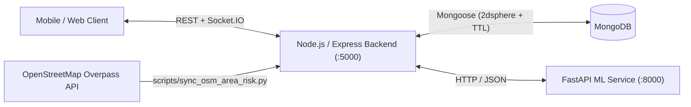

# SafeCity

**Context-Aware Personal Safety & Behavioral Intelligence Platform**

SafeCity combines user-specific spatial-temporal behavioral modeling, objective area-risk intelligence, user-declared activity sessions, and real-time Socket.IO escalation to detect genuine safety risks while minimizing false emergency alerts.

---

## Architecture



- **`backend/`** — Express 5 API, JWT authentication, Socket.IO real-time server, MongoDB persistence, context-aware decision engine, alert escalation scheduler, and privacy controls.
- **`ml_service/`** — FastAPI microservice using NumPy and scikit-learn (Haversine DBSCAN clustering, feature engineering, behavioral anomaly scoring, adaptive EMA learning, and spatial-temporal area safety fusion).
- **`scripts/`** — Real-world GPS trace replay (`replay_real_data.py`), OpenStreetMap area-risk sync (`sync_osm_area_risk.py`), and ML evaluation (`evaluate_ml.py`).

---

## Key Features

### 1. Personalized Behavioral Learning & Anomaly Detection
- **Spatial DBSCAN Clustering:** Learns each user's regular places (`eps=100 m`, `min_samples=5`, Haversine metric) with bounding-box and 95th-percentile radius boundaries, without forcing restrictive speed filters.
- **Routine Routes & Baselines:** Extracts recurring cluster-to-cluster transitions, hourly/weekday activity distributions, and movement speed baselines (`meanSpeedMps`, `speed95Mps`).
- **Data Sufficiency Guard:** Requires at least **50 valid points spanning 7 days** before activating a profile (`profileReady: false` otherwise).
- **Explainable Anomaly Scoring:** Scores incoming locations across four weighted signals: `unusualLocation`, `unusualTravelTime`, `unusualRoute`, and `abnormalMovement`.

### 2. Adaptive Behavioral Learning
- **Rolling 30-Day Window & Periodic Re-clustering:** Automatically refreshes stale profiles every 6 hours (`POST /api/ml/behavior-profile/adapt` for on-demand runs).
- **Gradual Routine Adaptation:** Blends updated speed and time-of-day baselines with previous profiles using Exponential Moving Average (EMA).
- **Anomaly Exclusion:** Filters out points recorded during escalated/help `SafetyAlert` windows and requires clusters to appear across at least **2 distinct calendar days** so one-off events aren't learned as permanent routines.

### 3. Area Safety Intelligence
- **Geospatial Area Risk (`AreaRisk`):** Stores `2dsphere`-indexed zones with `baseRiskScore`, `riskFactors`, `confidence`, and `dayMultiplier` / `nightMultiplier` / `weekendMultiplier`.
- **Trusted OpenStreetMap Data:** `scripts/sync_osm_area_risk.py` imports objective OSM features—unlit paths/streets (`lit=no`) and safe hubs (`police`, `hospital`, `public_transport=station`)—into `POST /api/area-risk/official` (guarded by `X-Admin-Key`).
- **Spam-Resistant Crowd Reports:** User reports (`POST /api/area-risk`) are locked to `source: "crowd_report"`, start at low confidence (`0.25`), deduplicate by unique `reporters`, and scale confidence only as distinct users corroborate.

### 4. Context-Aware Safety Decision Engine & Safe Sessions
- **User Preferences (`Preference`):** Respects `lateNightThreshold`, `enableUnknownAreaAlerts`, `deviationSensitivity`, and `autoAlertTrustedContacts`.
- **Declared Activities (`SafeSession`):** Users can start timed sessions (`commute`, `jogging`, `cycling`, `night_shift`, `traveling`, `social_event`, `custom`) with expected speed caps, anchor locations, and time/location alert suppression.
- **Anti-False-Alarm Escalation:** Combines environmental risk and adjusted behavioral risk into `contextualRiskLevel` (`low`, `moderate`, `elevated`, `critical`) and `recommendedAction` (`none`, `log_only`, `user_checkin`, `confirm_sos`).

### 5. Alerting, Escalation & Real-Time Communication
- **Check-Ins & Timeout Escalation:** High/elevated decisions automatically open a `pending_checkin` alert (`120s` or `60s` deadline) and emit `checkin:prompt` over Socket.IO. A 30-second background sweep escalates overdue non-responses and notifies active `TrustedContact`s (via `ALERT_WEBHOOK_URL` and Socket.IO).
- **Manual SOS:** `POST /api/alerts/sos` immediately escalates and dispatches emergency notifications with a Google Maps link.
- **Live Location Sharing:** `POST /api/live-share/start` creates a time-limited `shareToken` room (`share:<token>`) so trusted contacts can view real-time `live-share:location` and `emergency:status` updates.

### 6. Security, Privacy & Monitoring
- **Privacy & Consent (`/api/privacy`):** Users can toggle `locationTrackingConsent` (enforced with `403` on `/api/location/update`), configure `dataRetentionDays`, or purge all stored location/profile/alert data via `DELETE /api/privacy/location-data`.
- **Rate Limiting & Health Monitoring:** In-memory rate limiters on `/api/auth` and `/api/ml`, Helmet security headers, and `GET /health` reporting MongoDB and ML service status.

---

## Quick Start

### Option A: Docker Compose (Recommended)
```powershell
docker compose up --build
```
Starts MongoDB (`:27017`), FastAPI ML Service (`:8000`), and Node.js Backend (`:5000`) with built-in health checks.

### Option B: Local Development
1. **Configure `backend/.env`** (copy from `backend/.env.example`):
   ```env
   PORT=5000
   MONGO_URI=mongodb://127.0.0.1:27017/safecity
   JWT_SECRET=replace-with-a-long-random-secret
   ML_SERVICE_URL=http://127.0.0.1:8000
   ML_SERVICE_TIMEOUT_MS=5000
   ML_SERVICE_API_KEY=
   ADMIN_API_KEY=replace-with-admin-key
   ALERT_WEBHOOK_URL=
   ```
2. **Start the ML service:**
   ```powershell
   cd ml_service
   python -m pip install -r requirements.txt
   python -m uvicorn main:app --port 8000
   ```
3. **Start the backend:**
   ```powershell
   cd backend
   npm install
   npm start
   ```

---

## API Overview

| Domain | Endpoints | Auth |
| :--- | :--- | :--- |
| **Auth** | `POST /api/auth/register`, `POST /api/auth/login` | Public (rate-limited) |
| **Location** | `POST /api/location/update`, `GET /api/location/history` | JWT (`Bearer`) |
| **ML & Safety** | `POST /api/ml/location-risk`, `POST /api/ml/behavior-profile/learn`, `POST /api/ml/behavior-profile/adapt`, `POST /api/ml/behavior/analyze`, `POST /api/ml/safety-assessment` | JWT (`Bearer`) |
| **Area Risk** | `POST /api/area-risk`, `GET /api/area-risk/nearby` | JWT (`Bearer`) |
| **Area Risk (Admin)** | `POST /api/area-risk/official`, `PATCH /api/area-risk/:id` | `X-Admin-Key` |
| **Safe Sessions** | `POST /api/safe-sessions`, `GET /api/safe-sessions/active`, `PATCH /api/safe-sessions/:id/end` | JWT (`Bearer`) |
| **Alerts & SOS** | `GET /api/alerts`, `POST /api/alerts/sos`, `POST /api/alerts/:id/respond`, `POST /api/alerts/process-escalations` | JWT (`Bearer`) |
| **Live Share** | `POST /api/live-share/start`, `POST /api/live-share/stop`, `GET /api/live-share/active`, `GET /api/live-share/view/:token` | JWT / Share Token |
| **Preferences & Contacts** | `/api/preferences`, `/api/contacts` | JWT (`Bearer`) |
| **Privacy & Health** | `GET /api/privacy`, `PATCH /api/privacy/consent`, `DELETE /api/privacy/location-data`, `GET /health` | JWT / Public |

---

## Testing & Evaluation

- **Backend Unit & Security Tests:**
  ```powershell
  cd backend
  npm test
  ```
- **ML Precision, Recall & False-Positive Evaluation:**
  ```powershell
  python scripts/evaluate_ml.py
  ```
- **Replay Real GPS Datasets (`.plt` / `.gpx` / `.csv` or `.zip`):**
  ```powershell
  python scripts/replay_real_data.py --input "path\to\Geolife\Data\000\Trajectory" --email user000@example.com
  ```
- **Sync OpenStreetMap Area Risk Data:**
  ```powershell
  python scripts/sync_osm_area_risk.py --lat 40.0015 --lon 116.3248 --admin-key your-admin-key
  ```
